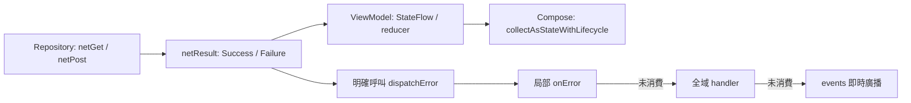

# MVVM、MVI 與 Compose

新增的 API 可與既有 `Get().await()`、`scopeNetLife` 並存。Repository 直接回傳 suspend 資料；ViewModel 決定結果、狀態及錯誤處理；Compose 只收集狀態。核心不依賴 Compose，也不要求繼承特定 ViewModel。



## 選擇入口

| 需求 | API | 執行與錯誤契約 |
| --- | --- | --- |
| Repository 單次請求 | `netGet<T>`、`netPost<T>` 等 | 準備、網路及轉換在 IO；直接回傳資料或拋例外 |
| 已建立的 request | `request.await<T>()` 或 `await<T>(type)` | 執行及轉換在 IO；先前建構 request 的工作仍在原執行緒 |
| 明確成功／失敗 | `netResult { ... }` | 回傳 `NetResult`；預設不分發、不 Toast、不切執行緒 |
| 觀察單次請求狀態 | `netFlow { ... }` | 冷 Flow；每次收集為 Loading → Success／Failure |
| 顯式錯誤處理 | `result.dispatchError(...)` | 局部 → 全域 → 即時廣播，回傳原結果 |
| 已有舊 Scope | `Get<T>().await()`／`scopeNetLife` | 保留既有契約；舊 Scope 使用 `NetConfig.errorHandler` |

提供 GET、POST、HEAD、OPTIONS、TRACE、DELETE、PUT、PATCH 八個 suspend 入口。仍使用既有 request DSL、converter、interceptor、Base URL 與 tag。

```kotlin
import com.drake.net.netGet
import com.drake.net.netPost
import com.drake.net.request.await

class ProfileRepository(private val baseUrl: String) {
    suspend fun profile(): String = netGet("/profile") {
        setBaseUrl(baseUrl)
        param("detail", true)
    }
}

// 既有 request 也可以使用 main-safe await：
// val text = Net.get("https://example.com/health").await<String>()
```

這些入口沿用 converter；自訂 DTO 仍需設定專案的 JSON converter。回傳 `okhttp3.Response` 時，body 所有權交給呼叫者，後續讀取不在取消綁定範圍；必須自行關閉 response。

## 結果與請求狀態

```kotlin
import com.drake.net.netResult
import com.drake.net.result.NetResult

val result = netResult { repository.profile() }
when (result) {
    is NetResult.Success -> render(result.value)
    is NetResult.Failure -> showError(result.error.kind)
}
```

`NetResult` 提供 `map`、`fold`、`onSuccess`、`onFailure`、`getOrNull`、`getOrThrow`。`map` 與回呼的例外直接向外傳播。`Success(null)` 是有效成功，若需區分失敗應比對型別，不只看 `getOrNull()`。

`NetFailure` 保留 `cause`、`kind`、`httpCode`。`httpCode` 是 HTTP 狀態碼；業務碼仍由應用 converter 的 `ResponseException.tag` 表達。請將 kind／業務碼轉成 UI 文案，不直接顯示原始例外訊息。

`NetState` 包含 `Idle`、`Loading`、`Success(value)`、`Failure(error)`。`Idle` 供初始狀態使用，`netFlow` 不額外發出 Idle。它代表單次請求，可被 App 自己的 `UiState` 包含，不取代分頁、保留舊資料重新整理等完整畫面狀態。

## MVVM 與 MVI

可編譯範例位於 [DemoViewModels.kt](../sample/src/main/java/com/drake/net/sample/modern/DemoViewModels.kt)，從 sample 側邊選單的 **MVVM / MVI Compose** 進入。

- MVVM：`load()` 用 `viewModelScope` 啟動 `netResult`，更新唯讀 `StateFlow`，失敗時明確呼叫 dispatcher。
- MVI：`accept(Load)` 啟動 `netFlow`，將狀態轉成 `DemoUiState`，一次性完成提示由有界 Channel 交給唯一 collector。
- 新載入會取消舊 Job；舊請求即使在取消後返回，`netResult` 的取消檢查也不會把它當成成功。
- 網路庫不自建作用域、不持有 Activity，也不提供全域 ViewModel。App 決定並行、取最新或串行政策；搜尋可使用 `flatMapLatest`。

Compose 的狀態收集：

```kotlin
import androidx.lifecycle.compose.collectAsStateWithLifecycle
import androidx.compose.runtime.getValue

val state by viewModel.state.collectAsStateWithLifecycle()
```

事件收集使用 `LaunchedEffect` 與 `repeatOnLifecycle(STARTED)`；Fragment 內的 ComposeView 使用 `DisposeOnViewTreeLifecycleDestroyed`。完整接線見 [ModernRequestFragment.kt](../sample/src/main/java/com/drake/net/sample/modern/ModernRequestFragment.kt)。Compose 相關依賴只加入 sample，消費端自行加入 `lifecycle-runtime-compose`。

## 全域錯誤與下發

在 Application 啟動時設定一次，之後訂閱同一實例：

```kotlin
import com.drake.net.NetConfig
import com.drake.net.error.NetErrorDispatcher

NetConfig.errorDispatcher = NetErrorDispatcher { failure ->
    // 在這裡記錄、更新 App 狀態或處理特定業務失敗。
    // 已處理且不希望再通知 UI 時回 true；false 繼續廣播。
    false
}
```

局部處理優先：

```kotlin
import com.drake.net.result.dispatchError

val result = netResult { repository.profile() }
result.dispatchError { failure ->
    if (failure.httpCode == 404) {
        // 更新此畫面的空狀態。
        true
    } else false
}
```

Flow 可明確啟用同一分發規則：

```kotlin
import com.drake.net.netFlow

val request = netFlow(errorDispatcher = NetConfig.errorDispatcher) {
    repository.profile()
}
```

局部或全域回傳 true 只代表已處理提示／副作用，結果及 Flow 終態仍保留 Failure。`netFlow` 會在 Failure 終態前執行處理器；處理器若掛起會延後終態，若拋錯則向外結束。需要先保留畫面失敗狀態時，可採 sample MVVM 的「更新 state，再 dispatch」。

`NetConfig.errorDispatcher.events` 是唯讀 SharedFlow，所有活躍訂閱者都會收到通知。建議 App 根層只有一處負責 Snackbar，避免多處同時提示。它沒有 replay，預設最多緩衝 64 筆；慢訂閱者超量時丟最舊事件，沒有訂閱者時直接丟棄。這是即時通知，不是可靠訊息佇列。

登入失效、帳號切換或其他必要工作應由 handler 更新 App 的狀態來源，再由 UI 觀察。不要只依賴 events 執行這些動作。handler 不自動跳 Main，會在呼叫者 context 執行；並行請求可並行呼叫 handler，業務互斥與去重留在 App。替換 dispatcher 實例不會搬移舊訂閱，請於啟動時設定或以依賴注入持有固定實例。

每次 `dispatchError` 都代表一次明確分發。只在一個邊界呼叫，不要 Repository 與 ViewModel 都分發同一結果。新 API 不會自動呼叫舊 `NetConfig.errorHandler`；需要舊 Toast 行為時，可在明確選用的 handler 內呼叫它並回 true。

## 取消、重試與冷 Flow

- `CancellationException`（包含任意深度的 cause 包裝）重新拋出，不變成 Failure、不全域分發。fatal `Error` 不會被包成一般失敗；舊 converter／interceptor 包裝在 cause 內的 Error 也會重新拋出。
- `netResult` 只捕捉請求區塊；Flow 的下游 emit／UI 回呼及 handler 錯誤不會被誤判成網路錯誤。
- `netResult` 不改變區塊內自行使用的 `async` 親子關係。並行且需要隔離失敗時，仍使用 `supervisorScope`。
- 每次收集冷 Flow 會重做請求。`stateIn(WhileSubscribed(...))` 停止後重新訂閱也可能重做；寫入操作應由 ViewModel 的明確動作啟動，不放進會重收集的讀取流。
- 不自動重試。轉成 Failure 值後，`Flow.retry` 不會重試該值；需要重試時在結果轉換前制定次數、條件及延遲，先確認請求可安全重放。
- `BaseRequest` 是可變 builder，不應跨 coroutine 同時共用；每次請求／每次 Flow 收集建立新 request。

## 遷移與驗證

可先把 Repository 中的 `coroutineScope { Get<T>(...).await() }` 換成 `netGet<T>(...)`，再由 ViewModel 選擇 `netResult` 或 `netFlow`。既有 Scope 不需一次遷移，也不需更換 JSON 協定。新增 API 來自目前原始碼；倉庫內舊 dist／已發布 AAR 不會自動包含它，請重新建置後再接入。

契約測試位於 `net/src/test/.../result`、`error`、`request/SuspendRequestTest.kt`，使用本機 socket 與受控 coroutine。sample 有 fake Repository 的 ViewModel 回歸。這些證據不代表裝置／E2E 或正式服務已驗。

設計依據：[Android Data layer](https://developer.android.com/topic/architecture/data-layer#expose-apis)、[UI state production](https://developer.android.com/topic/architecture/ui-layer/state-production)、[UI events](https://developer.android.com/topic/architecture/ui-layer/events)、[Kotlin Flow catch](https://kotlinlang.org/api/kotlinx.coroutines/kotlinx-coroutines-core/kotlinx.coroutines.flow/catch.html)、[SharedFlow](https://kotlinlang.org/api/kotlinx.coroutines/kotlinx-coroutines-core/kotlinx.coroutines.flow/-shared-flow/)。
